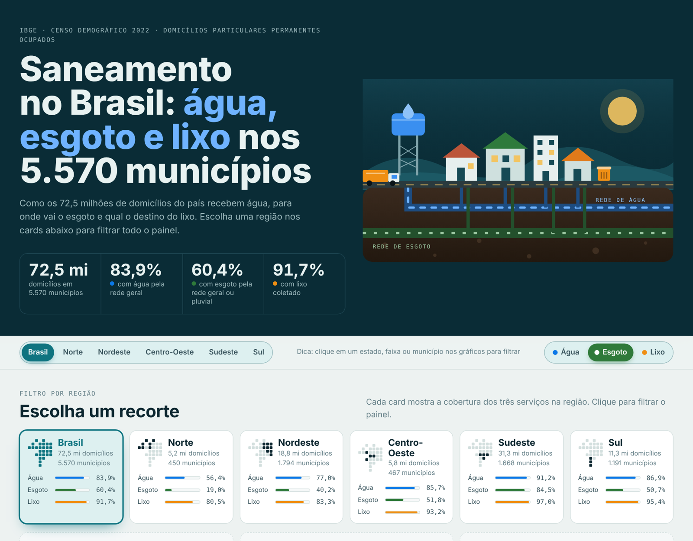
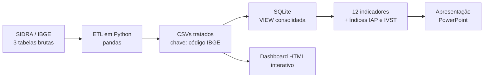

# Saneamento Básico no Brasil · Censo IBGE 2022

**Análise da infraestrutura sanitária dos 5.570 municípios brasileiros (água, esgoto e lixo), do dado bruto do IBGE ao dashboard interativo.**

[](https://zxcortes.github.io/Saneamento-censo-2022-Analise_de_Dados/)
[-B7472A?style=for-the-badge&logo=microsoftpowerpoint&logoColor=white)](apresentacao/Apresentacao_Resultados_Censo_2022.pptx)


[](https://zxcortes.github.io/Saneamento-censo-2022-Analise_de_Dados/)

---

## Apresentações

| | Formato | Conteúdo |
|---|---|---|
| **[Dashboard interativo](https://zxcortes.github.io/Saneamento-censo-2022-Analise_de_Dados/)** | Site (abre no navegador) | Visão geral do país, filtro por região, mapa dos estados, comparação regional, histograma e ranking dos 5.570 municípios, com filtro cruzado estilo BI |
| **[Apresentação dos resultados](apresentacao/Apresentacao_Resultados_Censo_2022.pptx)** | PowerPoint (9 slides) | Metodologia, indicadores e conclusões da análise |

### Como usar o dashboard
- **Região:** escolha nos cards ou na barra do topo.
- **Tema:** alterne entre Água, Esgoto e Lixo.
- **Filtro cruzado:** clique em um estado (mapa ou ranking), numa faixa do histograma ou num município da tabela, e o painel inteiro se atualiza. Escolher outra região limpa esses filtros.

---

## Principais resultados

Percentual de domicílios atendidos em cada serviço:

| Recorte | Água pela rede geral | Esgoto pela rede geral ou pluvial | Lixo coletado |
|---|---:|---:|---:|
| **Brasil** | **83,9%** | **60,4%** | **91,7%** |
| Sudeste | 91,2% | 84,5% | 97,0% |
| Sul | 86,9% | 50,7% | 95,4% |
| Centro-Oeste | 85,7% | 51,8% | 93,2% |
| Nordeste | 77,0% | 40,2% | 83,3% |
| Norte | 56,4% | 19,0% | 80,5% |

- **O esgoto é o maior gargalo do país:** 15,9 milhões de domicílios (21,9%) ainda usam fossa rudimentar, vala, despejam em rios ou não têm banheiro.
- **A desigualdade regional é extrema:** no Norte, só 19% dos domicílios estão ligados à rede de esgoto, contra 84,5% no Sudeste.
- **9,1 milhões de domicílios** não têm ligação com a rede geral de água, e **5,8 milhões** queimam, enterram ou descartam o lixo em terreno baldio.

---

## Pipeline



1. **Coleta:** tabelas 6803 (água), 6805 (esgoto) e 6892 (lixo) do SIDRA/IBGE, com domicílios particulares permanentes ocupados.
2. **ETL (`etl/codigo_etl.py`):** isola o código IBGE de 7 dígitos como chave primária, separa UF e nome do município, renomeia as colunas e trata valores nulos.
3. **Banco de dados:** importação no SQLite e criação da VIEW `vw_saneamento_consolidado`, que une as três tabelas por `INNER JOIN` no código do município.
4. **Análise SQL (`sql/consultas_saneamento.sql`):** 12 indicadores percentuais e 2 índices integrados.
5. **Visualização:** dashboard HTML/CSS/JS sem dependências externas e apresentação em PowerPoint.

### Índices integrados

```sql
-- Índice de Atendimento Pleno (IAP): média da cobertura adequada nos 3 serviços
IAP  = (p_cobertura_agua + p_cobertura_esgoto + p_coleta_lixo) / 3.0

-- Índice de Vulnerabilidade Sanitária Total (IVST): média dos déficits
IVST = (p_vulnerabilidade_hidrica + p_esgotamento_inadequado + p_descarte_inadequado) / 3.0
```

O modelo de dados está em [`sql/der_saneamento.png`](sql/der_saneamento.png).

---

## Estrutura do repositório

```
├── README.md
├── apresentacao/
│   └── Apresentacao_Resultados_Censo_2022.pptx   ← apresentação dos resultados
├── docs/
│   ├── index.html                                ← dashboard (publicado no GitHub Pages)
│   └── img/preview.png
├── dados/
│   ├── brutos/                                   ← tabelas originais do SIDRA/IBGE
│   └── tratados/                                 ← saída do ETL
├── etl/
│   └── codigo_etl.py
├── sql/
│   ├── consultas_saneamento.sql
│   └── der_saneamento.png
└── requirements.txt
```

## Como reproduzir

```bash
git clone https://github.com/zxcortes/Saneamento-censo-2022-Analise_de_Dados.git
cd Saneamento-censo-2022-Analise_de_Dados
pip install -r requirements.txt
python etl/codigo_etl.py        # lê dados/brutos/ e grava dados/tratados/
```

Depois, importe os três CSVs de `dados/tratados/` no SQLite (com os nomes `t_Agua_Municipio`, `t_Esgoto_Municipio` e `t_Lixo_Municipio`) e execute `sql/consultas_saneamento.sql`.

Para ver o dashboard localmente, basta abrir `docs/index.html` no navegador.

---

## Fonte dos dados

IBGE, Censo Demográfico 2022: características dos domicílios (SIDRA, tabelas 6803, 6805 e 6892). A unidade de análise é o domicílio particular permanente ocupado (72.456.368 domicílios).

## Autor

**Arão de Almeida Côrtes**
[github.com/zxcortes](https://github.com/zxcortes)
